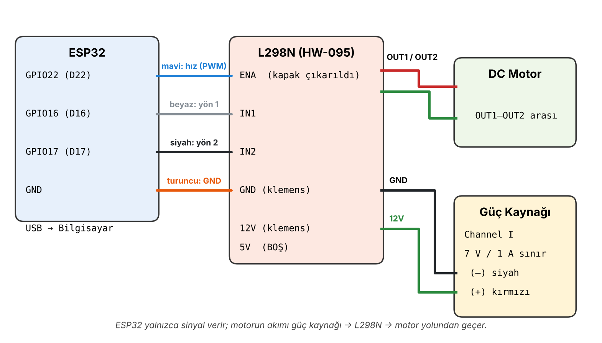

# 03.1 · DC Motor + L298N (H Köprüsü)

ESP32 ile bir DC motorun yönünü ve hızını L298N motor sürücü üzerinden kontrol eder. Komutlar Serial Monitor'den verilir.

## Bağlantılar
| L298N | ESP32 | Görevi |
|---|---|---|
| ENA (kapak çıkarılır) | GPIO 22 | Hız (PWM) |
| IN1 | GPIO 16 | Yön 1 |
| IN2 | GPIO 17 | Yön 2 |
| GND klemensi | GND | Ortak referans |
| 12V klemensi | Güç kaynağı (+), 7 V / 1 A sınır | Motor beslemesi |
| OUT1 / OUT2 | Motor uçları | |

ESP32 yalnızca sinyal verir; motorun akımı güç kaynağı → L298N → motor yolundan geçer.

## Komutlar (115200 baud)
| Komut | İşlev |
|---|---|
| `i` | İleri |
| `g` | Geri (dönerken önce 300 ms durur) |
| `d` | Dur |
| `+` / `-` | Hızı 25 artır / azalt (100–255 arası) |

## Notlar
- Testte 100'ün altındaki PWM değerlerinde motor dönmeyip yalnızca akım çekti; bu yüzden **minimum hız 100** olarak sınırlandı.
- Duruştan kalkarken 150 ms tam güç verilir (**kalkış takviyesi**), böylece düşük hızlarda da motor güvenle döner.
- Ayrıntılı anlatım: [01_DC_Motor_L298N_Ozet.docx](01_DC_Motor_L298N_Ozet.docx)
